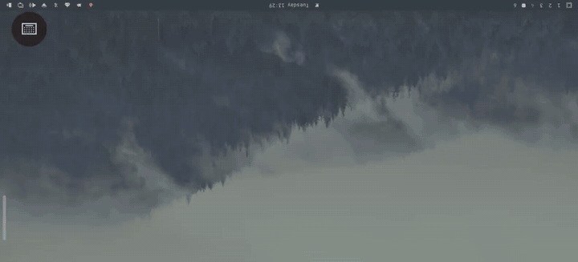
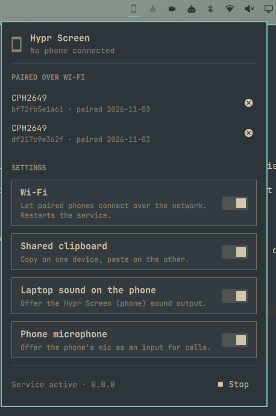

# Hypr Screen for the Omarchy bar

**Your Android phone as a second Hyprland screen, one click away in the bar.**

[Hypr Screen](https://github.com/kpanuragh/hypr-screen) turns an Android phone into a real Hyprland monitor over USB or Wi-Fi, with touch, the phone keyboard, a shared clipboard, laptop sound on the phone and the phone mic for calls. This widget puts all of it in the Omarchy bar.

<p align="center">
  <a href="https://github.com/kpanuragh/hypr-screen/raw/main/docs/demo.mp4"></a>
  <br><sub>The phone as a Hyprland monitor. <a href="https://github.com/kpanuragh/hypr-screen/raw/main/docs/demo.mp4">Full video (MP4)</a></sub>
</p>

<p align="center"></p>

The bar shows a phone icon, dimmed while no phone is connected. Click it for a panel where you can:

- see the connected phone and disconnect it, or move the focused window to it (middle-click the icon also disconnects);
- forget phones paired over Wi-Fi (click twice to confirm);
- turn Wi-Fi, the shared clipboard, laptop sound on the phone and the phone microphone on or off. Clipboard, sound and mic switch at once, and also in the phone app (Hypr Screen 0.8.0 on both sides). Wi-Fi restarts the service, which drops a connected phone;
- while the phone plays laptop sound, choose which apps play on it;
- start or stop the Hypr Screen service.

## Requirements

- Omarchy with the Quickshell bar.
- **Hypr Screen 0.8.0 or newer** on the laptop, with its service installed, plus the Hypr Screen app on the phone. See [its README](https://github.com/kpanuragh/hypr-screen#install). Without it, the panel says that hypr-screen is not installed (or too old) and its controls are disabled.
- For the per-app sound list: `pactl` (pipewire-pulse), which Hypr Screen already needs for laptop sound.

The widget runs the `hypr-screen` command (from `~/.local/bin`, the mise shims or your `PATH`; see `bin/hypr-screen`). It changes `~/.config/hypr-screen/config.json` only when you click one of its toggles, and keeps the rest of that file as it is.

## Install

From the [Omarchy plugin marketplace](https://plugins.omarchy.org), or:

```sh
omarchy plugin add https://github.com/kpanuragh/omarchy-hypr-screen --enable
```

Hypr Screen can also install this widget itself (`hypr-screen --install-omarchy`, or its `install.sh` on Omarchy). Use one way, not both: `omarchy plugin update` updates a marketplace install, and `--install-omarchy` reinstalls its own copy.

## Settings

Set these on the widget's entry in `bar.layout` of `~/.config/omarchy/shell.json`:

| Key | Default | Meaning |
|---|---|---|
| `hideWhenIdle` | `false` | Show the icon only while a phone is connected |
| `refreshIntervalSec` | `5` | How often the icon checks the connection (the open panel refreshes every 2 s) |

For example: `omarchy bar set kpanuragh.hypr-screen hideWhenIdle true --json`.

## Remove

```sh
omarchy plugin remove kpanuragh.hypr-screen
```

This removes only the widget. Hypr Screen itself stays installed; remove its service with `hypr-screen --uninstall-service`.

## License

MIT, see [LICENSE](LICENSE). The widget's source also lives in the [hypr-screen repository](https://github.com/kpanuragh/hypr-screen/tree/main/omarchy).
